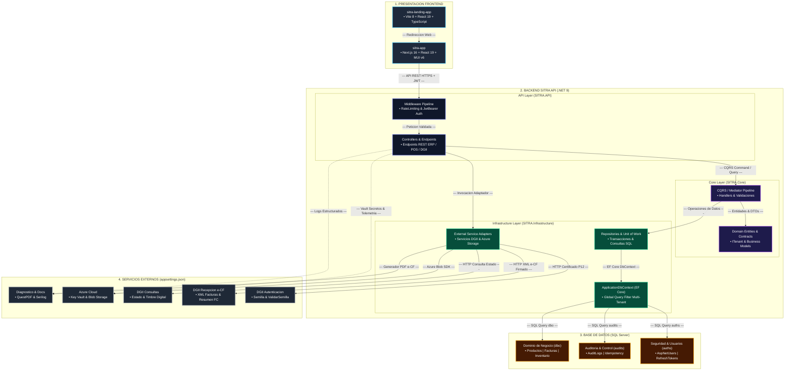

# Documentación de Arquitectura del Ecosistema SITRA

Este documento detalla la arquitectura global del sistema **SITRA**, abarcando las aplicaciones frontend (`sitra-landing-app` y `sitra-app`), la solución backend en .NET 9 (`SitraAPI`), la estructura de la base de datos SQL Server y las integraciones con servicios externos especificadas en `appsettings.json`.

---

## 1. Resumen Ejecutivo de la Arquitectura

El ecosistema **SITRA** está diseñado bajo una arquitectura desacoplada de micro-frontends y backend de API RESTful con **Clean Architecture** (Arquitectura Limpia):

- **`sitra-landing-app`**: Portal web público comercial y promocional.
- **`sitra-app`**: Aplicación web principal ERP/POS multi-inquilino (*multi-tenant*).
- **`SitraAPI`**: API RESTful central construida en **.NET 9 / ASP.NET Core**, dividida en capas (`API`, `Core`, `Infrastructure`, `Tests`), que soporta aislamiento de datos por empresa (*tenant*), auditoría avanzada, idempotencia e integración nativa con la **DGII** para Facturación Electrónica (e-CF) en la República Dominicana.

---

## 2. Diagrama General de Arquitectura (Mermaid Flowchart Compatible)

---

## 3. Desglose de Componentes y Capas

### A. Capa Frontend (Presentación Web)

1. **`sitra-landing-app`**:
   - **Tecnologías**: React 19, TypeScript, Vite 8.
   - **Función**: Landing page comercial pública. Presenta información del producto, planes de precios, testimonios, preguntas frecuentes y formularios de contacto. Enlaza a los usuarios directamente al portal web ERP/POS (`sitra-app`).

2. **`sitra-app`**:
   - **Tecnologías**: Next.js 16, React 19, Material UI (MUI v6), Zustand (gestión de estado), SWR / Axios (cliente HTTP), Tailwind CSS, Next-Intl (internacionalización).
   - **Función**: Plataforma de administración ERP/POS en la nube. Gestiona catálogos de productos, inventarios en almacenes, facturación de ventas/compras, cotizaciones, gestión de cobros/pagos, caja chica, clientes/proveedores y la interacción directa con el backend mediante tokens JWT Bearer.

---

### B. Capa Backend API (`SitraAPI`)

Construida con arquitectura por capas (*Clean Architecture*) para garantizar el desacoplamiento:

1. **`SITRA.API` (Capa de Presentación e Infraestructura HTTP)**:
   - **Controladores y Endpoints**: Exponen los servicios REST para autenticación, inventario, finanzas, facturación y la DGII.
   - **Pipeline de Middlewares**:
     - `IpBlockingMiddleware`: Bloquea direcciones IP con demasiados intentos fallidos.
     - `RateLimiting`: Limita las peticiones (ej. 20 peticiones por minuto por cliente).
     - `LocalizationMiddleware`: Gestiona el idioma y cultura de la petición.
     - `GlobalExceptionHandler`: Captura y estandariza las excepciones mediante `ProblemDetails`.
   - **Seguridad**: Autenticación mediante **JWT Bearer Token** (con validación de emisor, audiencia y llaves de firma) y seguridad mediante cabeceras HTTP (`X-Frame-Options`, `X-Content-Type-Options`, `X-XSS-Protection`).

2. **`SITRA.Core` (Capa de Aplicación y Dominio)**:
   - **Patrón CQRS / Mediator**: Manejo centralizado de solicitudes, comandos y consultas mediante un manejador personalizado.
   - **Interfaces y Abstracciones**: `ITenant` (aislamiento multi-inquilino) e `IAuditableEntity` (fechas y usuarios de creación/modificación).
   - **Validaciones**: `FluentValidation` para asegurar la integridad de las peticiones DTO antes de su procesamiento.

3. **`SITRA.Infrastructure` (Capa de Datos e Integraciones)**:
   - **Persistencia con EF Core**: `ApplicationDbContext` con soporte para migraciones automáticas en producción.
   - **Interceptores**: `AuditInterceptor` para llenar campos de auditoría automáticamente en cada `SaveChangesAsync`.
   - **Servicios de Almacenamiento e Integración**: Implementación de comunicaciones con Azure Blob Storage, firma digital XML y llamadas HTTP a la DGII.

---

### C. Base de Datos (SQL Server / Azure SQL)

La base de datos se gestiona a través de Entity Framework Core (`ApplicationDbContext`) y está estructurada en múltiples esquemas:

1. **Aislamiento Multi-Inquilino (*Multi-Tenancy*)**:
   - Cada entidad que implementa `ITenant` incluye un filtro de consulta global (`HasQueryFilter(e => e.TenantId == _currentTenantService.TenantId)`). Esto garantiza que un usuario solo tenga acceso a los datos pertenecientes a su empresa/tenant activo.

2. **Esquemas de Base de Datos**:
   - **`auths`**: Tabla de identidades y accesos (`AspNetUsers`, `AspNetRoles`, `AspNetUserRoles`, `RefreshTokens`, `TenantRoleUsers`, `Permissions`, `RolePermissions`).
   - **`audits`**: Registros de auditoría del sistema (`AuditLogs`) y peticiones repetidas (`IdempotentRequests`).
   - **`dbo` (Tablas del Dominio de Negocio)**:
     - *Productos e Inventario*: `Items`, `Categories`, `SubCategories`, `Brands`, `Models`, `Combos`, `Pricings`, `PricingItems`, `Warehouses`, `Stocks`, `Transfers`.
     - *Finanzas y Facturación*: `Invoices`, `InvoiceBillers`, `InvoiceBuyers`, `InvoiceFiscalSupports`, `InvoiceItems`, `Quotations`, `Payments`, `SpotPayments`, `SpotPayables`, `Receivables`, `Payables`, `Expenses`, `Taxes`, `PettyCash`, `PettyCashMovements`.
     - *Contactos y Administración*: `Contacts`, `Appointments`, `Deadlines`, `FiscalSupports`.

---

### D. Integraciones y Servicios Externos (`appsettings.json`)

1. **DGII (Dirección General de Impuestos Internos - Rep. Dominicana - Facturación Electrónica e-CF)**:
   - **Autenticación Comercial y Semilla**: `SemillaUrl` y `AutenticacionUrl` para obtener tokens de autenticación firmados.
   - **Recepción e-CF**: `RecepcionUrl` para el envío de facturas electrónicas XML y `RecepcionResumenUrl` para e-CF de consumo.
   - **Consultas y Estado**: `ConsultaUrl` para consultar el estado del e-CF, `AprobacionComercialUrl` para respuestas comerciales y `ConsultaTimbreUrl` para validación de timbres.
   - **Firma Digital & Schemas**: Firma con certificados PKCS#12 (`.p12`) mediante `ISignatureService` y validación contra esquemas XSD administrados centralizadamente.

2. **Servicios en la Nube de Azure**:
   - **Azure Key Vault**: Carga automática de secretos, cadenas de conexión y certificados en entornos que no son de desarrollo (`KeyVault:Url`).
   - **Azure Blob Storage**: Almacenamiento seguro en el contenedor `dgii-assets` para la conservación de archivos XML e-CF generados y esquemas XSD compartidos.
   - **Azure Application Insights**: Monitoreo en tiempo real, telemetría y diagnósticos de rendimiento.

3. **Motor de Generación de Documentos (QuestPDF)**:
   - Utilizado para el renderizado dinámico de facturas de venta, cotizaciones, recibos de pago y reportes financieros en formato PDF.

4. **Registro de Eventos y Diagnóstico (Serilog)**:
   - Configurado para registrar eventos estructurados en consola y enviar logs de advertencia/error a la infraestructura de monitoreo.
